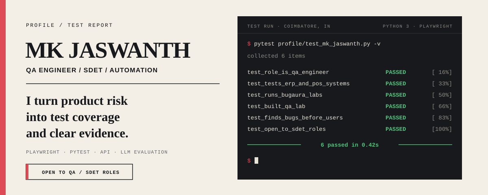
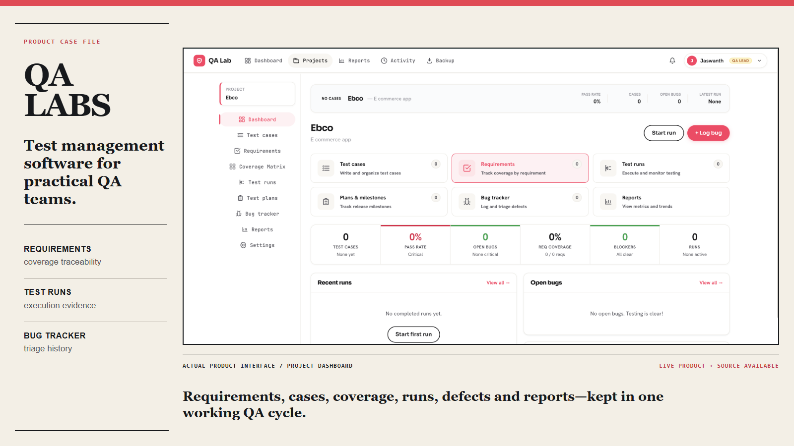
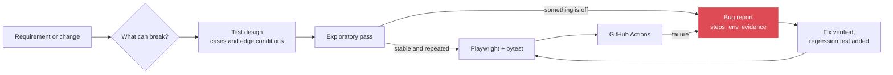

# MK Jaswanth

**QA Engineer at Crystal Code Labs · Founder of BugAura Labs · Coimbatore, India**

<a href="https://mkjaswanth.github.io/-Jaswanth-QA-portfolio/"><kbd>Portfolio ↗</kbd></a> <a href="https://bugauralabs.studio/"><kbd>BugAura Labs ↗</kbd></a> <a href="https://www.linkedin.com/in/mkjaswanth/"><kbd>LinkedIn ↗</kbd></a> <a href="mailto:jaswanth.mk63@gmail.com"><kbd>Email</kbd></a>

I test web, mobile, and AI products. At Crystal Code Labs most of my work is on restaurant and medical ERP/POS systems, where I mix manual and API testing with Playwright regression suites in Python and TypeScript.

Outside the day job I run BugAura Labs, a small QA studio that does short pre-launch audits for startups and agencies, and I build QA Lab, the test management tool I use for my own work. Before this I tested LLM and AI video pipelines. The same input could produce different output there, so I wrote evaluation rules instead of exact-match assertions.

I'm open to remote and full-time QA Engineer and SDET roles.

## QA Lab

On most teams I've tested for, requirements sit in one document, test cases in a spreadsheet, and bugs in a tracker that doesn't know about either. QA Lab keeps a full QA cycle in one place.

<a href="https://qaura.bugauralabs.studio/"><kbd>Open QA Lab ↗</kbd></a> <a href="https://github.com/Pandalabs-QA-Lab"><kbd>View Source ↗</kbd></a>

<b>What's inside QA Lab</b>

 

| Module | What it does |
| --- | --- |
| Requirements | Track scope and link each requirement to the cases that cover it |
| Test cases | Snapshot-versioned, so you can see what a case looked like when it ran |
| Coverage matrix | Requirement-to-test coverage at a glance, with gaps visible |
| Plans and runs | Group cases into milestones and record execution results |
| Bug tracker | Browser bug capture with triage history |
| Reports and activity | Real-time dashboards and an audit trail of who changed what |
| Backup | JSON backup and restore per project |

Built with TypeScript, React, and Firestore. Deployed on Vercel.

## Bug reports from real projects

Selected findings from client work and audits. Click a report to open it.

<b>BUG-01 · Crystal Billz ERP/POS</b> · <code>critical</code> · 14+ critical and high defects in one 24-hour cycle

 

**Scope:** manual, API, and Playwright regression across restaurant and medical workflows

**Found:**
- HTTP 500 when editing a branch
- Duplicate GSTINs accepted without a warning
- Suppliers deletable while purchase orders still referenced them
- Intermittent 403s with the app open in several tabs

<b>BUG-02 · Lead management system</b> · <code>high</code> · role checks and unhandled database errors

 

**Scope:** API checks and a Playwright TypeScript RBAC suite

**Found:**
- Unhandled Prisma P2002 errors surfacing as HTTP 500 on duplicate email updates
- Agent-role users could reach `/settings`
- The duplicate check matched partial strings, so valid records were rejected

<b>BUG-03 · EBCO e-commerce</b> · <code>critical</code> · purchase blocker and a privacy leak

 

**Scope:** 97 test cases across a change request, payments, and the Strapi CMS

**Found:**
- "Variant not found" blocked purchase of non-variant products during the 30-minute payment retry window
- A deleted account's order history reappeared when the same email registered again

<b>BUG-04 · B2B and D2C storefronts</b> · <code>high</code> · ClicksToCart, C2C Imex, RaceNation, PandaSpot

 

**Scope:** cross-browser, guest checkout, and PWA onboarding

**Found:**
- Cart subtotals went wrong when quantities changed
- 404s across 9 product categories
- Invalid reCAPTCHA keys in production
- Slider CTAs linking to the wrong pages
- QR and PWA onboarding edge cases

<b>EVAL-05 · AI products</b> · <code>non-deterministic</code> · Isaii AI, Instawork AI Labs, Christ Infotech

 

**Scope:** LLM, AI video, and NLP output evaluation

**Built:**
- Reusable heuristics for hallucination rate and semantic consistency, used where exact-match assertions don't work
- Clipping threshold checks for an AI video pipeline
- Sentiment-scoring validation across 10,000+ reviews

## How I test

## Selected work

| Project | What it is | Stack |
| --- | --- | --- |
| **[Billz E2E Test Framework ↗](https://github.com/MKJaswanth/Billz-E2E-Test-Framework)** | End-to-end framework for restaurant and medical ERP flows: master data, PO to GRN, FIFO inventory, billing, and vouchers. Runs in parallel with HTML reports on GitHub Actions. | Playwright, Python, pytest, POM |
| **[E-commerce Automation ↗](https://github.com/MKJaswanth/E-commerce_automation)** | 21 tests across login, inventory, cart, and checkout on SauceDemo, run on Chromium, Firefox, and WebKit with screenshots on failure. | Playwright, Python, pytest, GitHub Actions |
| **[Playwright Pytest QA Skill ↗](https://github.com/MKJaswanth/playwright-pytest-qa-skill)** | A Codex skill that scaffolds Playwright and pytest suites with UI and API tests, cleanup, HTML reports, failure artifacts, and CI. Listed on [QASkills ↗](https://qaskills.sh/skills/mkjaswanth/python-playwright-pytest-suite). | Python, Playwright, pytest |
| **[BugAura Labs ↗](https://bugauralabs.studio/)** | Site for my QA studio: 72-hour audit sprints, Playwright automation packages, and pre-launch checks. [Source ↗](https://github.com/MKJaswanth/BugAuraLabs) | Web, GitHub Pages |
| **MoodFlow** | A mental health prediction app using NLP on user text, with 85–90% model accuracy. I tested it manually and at the API level. | Django, Python, scikit-learn |

[Browse all repositories ↗](https://github.com/MKJaswanth?tab=repositories)

## Experience

- **QA Engineer / Junior Software Tester**, Crystal Code Labs · Apr 2026 – present
- **Founder and Lead QA Consultant**, BugAura Labs · current
- **Contract QA Specialist**, Instawork AI Labs · AI video pipeline QA
- **QA Engineer**, Isaii AI · web, mobile, and LLM evaluation
- **Data and Quality Validation Intern**, Christ Infotech · NLP sentiment scoring

**Education:** M.Sc. Data Science (2024–2026, CGPA 8.20) and B.Sc. Computer Science (2021–2024, CGPA 7.90), Nehru Arts and Science College, Coimbatore

## Toolkit

**Testing:** manual, exploratory, functional, regression, API, RBAC and access control, LLM output evaluation, defect lifecycle

**Automation:** Playwright (Python and TypeScript), pytest, Selenium, Page Object Model, fixtures, data-driven tests

**Tools:** Postman, Chrome DevTools, Git, GitHub Actions, Jira

**Languages and data:** Python, TypeScript, JavaScript, SQL, Django, FastAPI, Firebase/Firestore, pandas, scikit-learn

<b>Research, hackathons, and leadership</b>

 

- Presented a paper on LLM hallucination detection and quality evaluation for generative AI at ICCICT-2K26, the 3rd International Conference on Computational Intelligence and Communication Technologies.
- Led my team at Smart India Hackathon 2025 with an AI career guidance system in Python and FastAPI. Selected for Hac'KP 2025 (Kerala Police Cyberdome) and took part in EY Techathon 6.0.
- 1st place at Code Craft (Nehru Institute of Engineering), 2nd place at the Nehru College Hackathon, and 2nd place in debugging and paper presentation competitions.
- Chairman of the Phoenix Association at Nehru Arts and Science College.

## Contribution graph

Regenerated every morning from my GitHub activity.

<picture>
  <source media="(prefers-color-scheme: dark)" srcset="https://raw.githubusercontent.com/MKJaswanth/MKJaswanth/output/snake-dark.svg" />
  <source media="(prefers-color-scheme: light)" srcset="https://raw.githubusercontent.com/MKJaswanth/MKJaswanth/output/snake-light.svg" />
  
</picture>

## Outside QA

When I'm not testing, I'm usually listening to music, planning a trip, or reading something new. Anime also finds its way into the small visual projects I build for fun.

For QA Engineer or SDET roles, or a pre-launch audit through BugAura Labs: <a href="https://www.linkedin.com/in/mkjaswanth/"><kbd>LinkedIn ↗</kbd></a> <a href="mailto:jaswanth.mk63@gmail.com"><kbd>Email</kbd></a>
